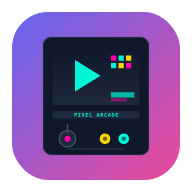

# Pixel Arcade 🕹️

> **300 classic browser games in one place** — Wordle, Quordle, Octordle, Nerdle, Worldle, Crosswordle, Movie Emoji,
> Tone Memory, Word Ladder, Word Chain, 2048, Snake, Sudoku, Memory Match, Minesweeper, Hangman, Connect Four,
> Battleship,
> and 285 more. Built with pure HTML, CSS &amp; JavaScript. No build step. No backend. No dependencies. Just push to
> GitHub Pages and play.

<p align="center">
  
</p>

<p align="center">
  <!-- Category icons — click any to jump to that section -->
  <a href="#-live-games-300">📝 Word (78)</a> ·
  <a href="#-live-games-300">🧩 Logic (90)</a> ·
  <a href="#-live-games-300">👾 Arcade (48)</a> ·
  <a href="#-live-games-300">♟️ Strategy (50)</a> ·
  <a href="#-live-games-300">🧠 Quiz (34)</a>
</p>

<p align="center">
  <a href="#-live-games-300">🎮 Games</a> ·
  <a href="#-features">✨ Features</a> ·
  <a href="#-quickstart">🚀 Quickstart</a> ·
  <a href="#-add-a-new-game">➕ Add a game</a> ·
  <a href="#-about-the-author">👤 Author</a> ·
  <a href="#-disclaimer">⚠️ Disclaimer</a>
</p>

---

## ⚠️ Disclaimer

**Trademark notice** — Game names like *Wordle*, *Quordle*, *Octordle*, *Nerdle*, *Worldle*, *Heardle*, *Framed*,
*Contexto*, *Semantle*, *Connections*, and *Spelling Bee* are trademarks of their respective owners (NYT, etc.). Pixel
Arcade is an **independent, fan-made clone** that is not affiliated with, endorsed by, or sponsored by any of those
rights holders. Each game here is a re-implementation of the genre's mechanics built from scratch under the MIT license;
the original names are used only to indicate the gameplay style. If you are a rights holder and want a name removed,
please open an issue.

**Content sources** — Some games fetch live content from public APIs at runtime:

- Wikipedia (`en.wikipedia.org`) for random article titles and summaries (Wordle, Hangman, Trivia)
- Open Trivia DB (`opentdb.com`) for trivia questions

These are public, CORS-enabled APIs with no API keys. All requests are made client-side; no data is sent to any server.
When offline, games fall back to bundled word lists and questions. The comprehensive English word list used for Wordle
validation (~8,500 five-letter words) is sourced from the [NLTK words corpus](https://www.nltk.org/nltk_data/) and
bundled locally in `js/wordlist.js`.

**No warranty** — This software is provided "as is" under the MIT license, without warranty of any kind. The games are
provided for entertainment and educational purposes only.

---

## 📋 Table of contents

- [🎯 Live games (300)](#-live-games-300)
- [✨ Features](#-features)
- [🚀 Quickstart](#-quickstart)
- [📂 Project structure](#-project-structure)
- [➕ Add a new game](#-add-a-new-game)
- [🎨 Theming](#-theming)
- [♿ Accessibility](#-accessibility)
- [📦 Tech stack](#-tech-stack)
- [👤 About the author](#-about-the-author)
- [📄 License &amp; community files](#-license--community-files)
- [🙋 FAQ](#-faq)
- [⚠️ Disclaimer](#-disclaimer)
- [🤖 AI credits](#-ai-credits)

---

## 🎯 Live games (300)

Each card on the home page has a unique thumbnail (see `assets/thumbnails/`). Click any card to play. Use the filter
chips to browse by category, or the search box to find a game by name.

<details>
<summary><b>📝 Word games (78)</b> — click to expand</summary>

| #  | Game                      | Highlights                                                                   |
|----|---------------------------|------------------------------------------------------------------------------|
| 1  | **📖 Anagram Crossword**  | Mini crossword — each clue is an anagram of the answer                       |
| 2  | **🔤 Anagram Hunt**       | Find as many words as possible from 6 letters — 60s                          |
| 3  | **🔤 Anagram Junior**     | Two-word anagrams for kids.                                                  |
| 4  | **🔀 Anagram Quiz**       | Unscramble the word from 4 choices                                           |
| 5  | **🔤 Anagram Race**       | Unscramble as many words as possible in 60 seconds                           |
| 6  | **🏛️ Ancient Wordle**     | Ancient Wordle — guess the 5-letter themed word in 6 tries.                  |
| 7  | **🐾 Animal Wordle**      | Animal Wordle — guess the 5-letter themed word in 6 tries.                   |
| 8  | **🦜 Bird Wordle**        | Bird Wordle — guess the 5-letter themed word in 6 tries.                     |
| 9  | **🫀 Body Wordle**        | Body Wordle — guess the 5-letter themed word in 6 tries.                     |
| 10 | **🎲 Boggle**             | Find words (≥3 letters) in the 4×4 letter grid                               |
| 11 | **🎲 Boggle Mini 4x4**    | Mini Boggle — find 3+ letter words.                                          |
| 12 | **🏙️ City Wordle**        | City Wordle — guess the 5-letter themed word in 6 tries.                     |
| 13 | **👕 Clothing Wordle**    | Clothing Wordle — guess the 5-letter themed word in 6 tries.                 |
| 14 | **🔢 Codeword Classic**   | Crossword with no clues — letters are numbers.                               |
| 15 | **🔤 Codewords**          | Crack the number→letter cipher to reveal hidden words                        |
| 16 | **🎨 Color Wordle**       | Color Wordle — guess the 5-letter themed word in 6 tries.                    |
| 17 | **🔗 Connections**        | Group 16 words into 4 hidden categories                                      |
| 18 | **🌍 Country Wordle**     | Country Wordle — guess the 5-letter themed word in 6 tries.                  |
| 19 | **🔤 Crosswordle**        | Solve 5 intersecting 5-letter words Wordle-style                             |
| 20 | **🔒 Cryptogram**         | Decode a quote, letter-by-letter.                                            |
| 21 | **🔐 Cryptoquote**        | Decode the substitution-cipher quote                                         |
| 22 | **⚗️ Element Wordle**     | Element Wordle — guess the 5-letter themed word in 6 tries.                  |
| 23 | **🎭 Emojidle**           | Guess the phrase from emoji clues                                            |
| 24 | **😊 Emotion Wordle**     | Emotion Wordle — guess the 5-letter themed word in 6 tries.                  |
| 25 | **🍔 Food Wordle**        | Food Wordle — guess the 5-letter themed word in 6 tries.                     |
| 26 | **👻 Ghost Word**         | Add letters without completing a word — vs AI                                |
| 27 | **🪢 Hangman**            | Guess the word before the stick figure is complete                           |
| 28 | **🏛️ Hangman Ancient**    | Ancient-world words.                                                         |
| 29 | **🌍 Hangman Geography**  | Country &amp; city names.                                                    |
| 30 | **🔄 Hangman Reverse**    | You&#x27;re the hangman — guess the AI&#x27;s hidden word                    |
| 31 | **💻 Hangman Tech**       | Technology words.                                                            |
| 32 | **💬 Idiom Guess**        | Pick the idiom that matches the literal description                          |
| 33 | **💬 Idiom Guess Jr.**    | Guess the idiom from a clue.                                                 |
| 34 | **💼 Job Wordle**         | Job Wordle — guess the 5-letter themed word in 6 tries.                      |
| 35 | **🔤 Jotto**              | Guess the 5-letter word; matches tell you how many letters are right         |
| 36 | **🔲 Letter Boxed**       | Chain words around a square — each letter from a different side              |
| 37 | **🧵 Letter Weaver**      | Fill in the missing letters — clue + word shape                              |
| 38 | **✨ Magic Wordle**       | Magic Wordle — guess the 5-letter themed word in 6 tries.                    |
| 39 | **🎬 Movie Emoji**        | Guess the movie title from emoji clues — 6 tries                             |
| 40 | **🎬 Movie Wordle**       | Movie Wordle — guess the 5-letter themed word in 6 tries.                    |
| 41 | **🎵 Music Wordle**       | Music Wordle — guess the 5-letter themed word in 6 tries.                    |
| 42 | **🐉 Mythical Wordle**    | Mythical Wordle — guess the 5-letter themed word in 6 tries.                 |
| 43 | **🌿 Nature Wordle**      | Nature Wordle — guess the 5-letter themed word in 6 tries.                   |
| 44 | **🧮 Nerdle**             | Guess the 8-character math equation in 6 tries                               |
| 45 | **🐳 Ocean Wordle**       | Ocean Wordle — guess the 5-letter themed word in 6 tries.                    |
| 46 | **🐙 Octordle**           | Solve 8 Wordle boards at once with 13 shared guesses                         |
| 47 | **🔁 Palindrome Hunt**    | Find the hidden palindromes.                                                 |
| 48 | **🅿️ Pangram Hunt**        | Find pangrams (words using all 7 letters)                                    |
| 49 | **📜 Proverb Match**      | Match the second half of an old proverb.                                     |
| 50 | **🔲 Quordle**            | Solve 4 Wordle boards at once with 9 shared guesses                          |
| 51 | **🎵 Rhyme Time**         | Pick the word that rhymes with the given word                                |
| 52 | **🚀 Space Wordle**       | Space Wordle — guess the 5-letter themed word in 6 tries.                    |
| 53 | **🐝 Spelling Bee**       | Form words (≥4 letters) from 7 letters — center letter required              |
| 54 | **⚽ Sport Wordle**       | Sport Wordle — guess the 5-letter themed word in 6 tries.                    |
| 55 | **⚔️ Swordle**            | Speed Wordle — race a 60-second timer                                        |
| 56 | **💻 Tech Wordle**        | Tech Wordle — guess the 5-letter themed word in 6 tries.                     |
| 57 | **🔨 Tool Wordle**        | Tool Wordle — guess the 5-letter themed word in 6 tries.                     |
| 58 | **🌳 Tree Wordle**        | Tree Wordle — guess the 5-letter themed word in 6 tries.                     |
| 59 | **📚 Vocabulary Quiz**    | Pick the right definition for each word                                      |
| 60 | **⛈️ Weather Wordle**     | Weather Wordle — guess the 5-letter themed word in 6 tries.                  |
| 61 | **🔗 Word Chain**         | Guess the secret word — distance tells you how close each guess is           |
| 62 | **🔗 Word Chain**         | Each word starts with the previous word&#x27;s last letter. vs AI.           |
| 63 | **🎯 Word Hunt**          | Find all dictionary words from 7 scrambled letters — 90 seconds              |
| 64 | **🔀 Word Jumble Easy**   | Unscramble 5-letter words, 30s.                                              |
| 65 | **🔀 Word Jumble Hard**   | Unscramble 7-letter words, 20s.                                              |
| 66 | **🔀 Word Jumble Medium** | Unscramble 6-letter words, 25s.                                              |
| 67 | **🪜 Word Ladder**        | Transform the START word into the END word, one letter at a time             |
| 68 | **🪜 Word Ladder**        | Change one word into another, one letter at a time                           |
| 69 | **🔺 Word Pyramid**       | Build words one letter at a time — A → AT → CAT → CHAT                       |
| 70 | **🔀 Word Scramble**      | Unscramble the letters before time runs out                                  |
| 71 | **🔍 Word Search**        | Find 8 hidden words in the letter grid                                       |
| 72 | **🔍 Word Search Junior** | Smaller 8x8 word search for new solvers.                                     |
| 73 | **🔳 Word Square**        | Fill the grid so each row &amp; column spells a word                         |
| 74 | **🗼 Word Tower**         | Stack words — each must start with the previous word&#x27;s last letter      |
| 75 | **🎡 Word Wheel Classic** | Classic British newspaper puzzle.                                            |
| 76 | **🔤 Wordle**             | Guess the word — Easy 4 / Classic 5 / Hard 6 letters, live Wikipedia answers |
| 77 | **🌌 Wordleverse**        | Wordle with selectable word length (3–8 letters)                             |
| 78 | **🌍 Worldle**            | Guess the country from its silhouette — distance + direction hints           |

</details>

<details>
<summary><b>🧩 Logic puzzles (90)</b> — click to expand</summary>

| #  | Game                            | Highlights                                                                          |
|----|---------------------------------|-------------------------------------------------------------------------------------|
| 1  | **🔢 15 Puzzle**                | Slide tiles 1–15 into order in a 4×4 grid                                           |
| 2  | **🔢 2048**                     | Combine matching tiles to reach 2048                                                |
| 3  | **🔢 24 Game**                  | Combine 4 numbers with +, -, ×, ÷ to make 24                                        |
| 4  | **🦁 Animal Memory 2**          | Animal Memory 2 — flip pairs of cards to clear the deck.                            |
| 5  | **🔢 Binairo**                  | Fill the grid with 0s and 1s — no 3 in a row, balanced                              |
| 6  | **🌉 Bridges (Hashi)**          | Connect islands with bridges — each island&#x27;s number = bridge count             |
| 7  | **🐂 Bulls and Cows**           | Predecessor of Mastermind — guess the digits.                                       |
| 8  | **🎨 Color Match**              | Are the two colors the same? Build a streak.                                        |
| 9  | **🔴 Color Memory 2**           | Color Memory 2 — flip pairs of cards to clear the deck.                             |
| 10 | **🎨 Color Slide**              | Slide tiles in rainbow order.                                                       |
| 11 | **➗ Cross Math**               | Mini crossword with math-clued number answers                                       |
| 12 | **🧮 Equation Builder**         | Arrange numbers &amp; operators to hit the target                                   |
| 13 | **🔢 Even Number Hunt**         | Even Number Hunt — hot/cold hints.                                                  |
| 14 | **🧩 Fillomino**                | Fill the grid so each n-group has exactly n cells                                   |
| 15 | **🇺🇸 Flag Memory 2**            | Flag Memory 2 — flip pairs of cards to clear the deck.                              |
| 16 | **🍕 Food Memory 2**            | Food Memory 2 — flip pairs of cards to clear the deck.                              |
| 17 | **🍎 Fruit Memory 2**           | Fruit Memory 2 — flip pairs of cards to clear the deck.                             |
| 18 | **📐 Futoshiki**                | Fill the grid so each row/col has 1-4, respecting inequality signs                  |
| 19 | **⪌ Futoshiki 7x7**             | Latin square with inequality clues.                                                 |
| 20 | **⬡ Hex Puzzle**                | Swap hex tiles so no two neighbors share a color                                    |
| 21 | **🧩 Hidato**                   | Connect numbers 1..N in sequence on the grid                                        |
| 22 | **⬛ Hitori**                   | Shade cells so no number repeats per row/column; shaded can&#x27;t touch            |
| 23 | **⬛ Hitori 9x9**               | Black out cells so no repeats.                                                      |
| 24 | **🟦 Hyper Sudoku**             | 4x4 Sudoku plus 2 extra 2x2 regions                                                 |
| 25 | **🎸 Instrument Memory 2**      | Instrument Memory 2 — flip pairs of cards to clear the deck.                        |
| 26 | **➕ Kakuro 15**                | Larger Kakuro with sums up to 15.                                                   |
| 27 | **➕ Kakuro Mini**              | 4×4 kakuro — fill cells so rows and columns sum to the clues                        |
| 28 | **🧮 KenKen**                   | 4×4 arithmetic sudoku — cages hit the target with +, −, ×, ÷                        |
| 29 | **🔤 Letter Slide**             | Slide letters to spell ABC…                                                         |
| 30 | **💡 Light Up (Akari)**         | Place bulbs to light every white cell — no two bulbs see each other                 |
| 31 | **💡 Lights Out**               | Toggle lights off — every click affects neighbors too                               |
| 32 | **💡 Lights Out 3x3**           | 3x3 — toggle self + 4 neighbors.                                                    |
| 33 | **💡 Lights Out 5x5+**          | 5x5 — toggle self + 4 neighbors.                                                    |
| 34 | **💡 Lights Out 7x7**           | 7x7 — toggle self + 4 neighbors.                                                    |
| 35 | **📐 Lights Out Corners**       | 5x5 — toggle 4 diagonal corners.                                                    |
| 36 | **✝️ Lights Out Cross**         | 5x5 — toggle 5-cell cross.                                                          |
| 37 | **➕ Lights Out Plus**          | 5x5 — toggle + shape (4 neighbors).                                                 |
| 38 | **💫 Lights Out Wrap**          | 5x5 with wrap-around edges.                                                         |
| 39 | **❌ Lights Out XOR**           | 5x5 — toggle self only.                                                             |
| 40 | **🧩 Logic Grid**               | Einstein puzzle — use clues to match people to attributes                           |
| 41 | **🔢 Magic Square**             | Arrange 1–9 in a 3×3 grid so every row, column &amp; diagonal sums to 15            |
| 42 | **🎨 Mastermind**               | Crack the secret 4-color code in 8 tries                                            |
| 43 | **🎨 Mastermind Classic**       | Original 1970s code-breaking game.                                                  |
| 44 | **⚪ Masyu**                    | Draw a single loop through all pearls — follow the pearl rules                      |
| 45 | **🃏 Memory Match**             | Flip cards and find all the matching pairs                                          |
| 46 | **💣 Minesweeper**              | Clear the board without detonating any mines                                        |
| 47 | **💣 Mini Minesweeper**         | 5×5 minesweeper with 4 mines — quick rounds                                         |
| 48 | **🔢 Mini Sudoku (3×3)**        | 3×3 Sudoku — place 1, 2, 3 in each row, column &amp; box                            |
| 49 | **🔢 Mini Sudoku (4×4)**        | Fill the 4×4 grid — 1–4 in each row, column, and 2×2 box                            |
| 50 | **🐉 Mythology Memory 2**       | Mythology Memory 2 — flip pairs of cards to clear the deck.                         |
| 51 | **🧠 N-Back**                   | Does the current letter match the one 2 steps back?                                 |
| 52 | **🔲 Nonogram**                 | 5×5 Picross — fill cells per the row/column clues                                   |
| 53 | **⬜ Nonogram 10x10**           | Larger Japanese logic puzzle (Hanjie).                                              |
| 54 | **🎯 Number Guess**             | Guess the secret number with hot/cold hints                                         |
| 55 | **🔟 Number Hunt 1-10**         | Number Hunt 1-10 — hot/cold hints.                                                  |
| 56 | **💯 Number Hunt 1-100**        | Number Hunt 1-100 — hot/cold hints.                                                 |
| 57 | **🎯 Number Hunt 1-1000**       | Number Hunt 1-1000 — hot/cold hints.                                                |
| 58 | **🔢 Number Hunt 1-50**         | Number Hunt 1-50 — hot/cold hints.                                                  |
| 59 | **🔢 Number Hunt 1-500**        | Number Hunt 1-500 — hot/cold hints.                                                 |
| 60 | **🔗 Number Link**              | Connect each numbered pair with a path. No crossings.                               |
| 61 | **🔢 Number Slide**             | Slide numbers in order.                                                             |
| 62 | **🔢 Numbrix**                  | Connect 1 to N sequentially in a grid.                                              |
| 63 | **🏝️ Nurikabe**                 | Shade cells to form islands of the right size, with a connected wall                |
| 64 | **🛤️ Path Puzzle**              | Draw a path from start to end, visiting every cell once                             |
| 65 | **🔵 Peg Solitaire**            | Jump pegs over each other to leave just one in the center                           |
| 66 | **🧊 Picross 3D**               | 3×3×3 cube — deduce filled cells from face clues                                    |
| 67 | **🏛️ Place Memory 2**           | Place Memory 2 — flip pairs of cards to clear the deck.                             |
| 68 | **🔍 Prime Number Hunt**        | Prime Number Hunt — hot/cold hints.                                                 |
| 69 | **🌊 Ripple Effect**            | Fill regions with 1..N; no two same numbers touch (incl. diagonally)                |
| 70 | **▭ Shikaku**                   | Divide the grid into rectangles — each holds one number = area                      |
| 71 | **🏙️ Skyscrapers**              | Place buildings 1–4 in each row/col so the visibility clues work                    |
| 72 | **🏙️ Skyscrapers 6x6**          | 6x6 skyscraper deduction puzzle.                                                    |
| 73 | **🧩 Sliding 3x3**              | 3x3 sliding puzzle (1-8).                                                           |
| 74 | **🧩 Sliding 4x4**              | 4x4 sliding puzzle (1-15).                                                          |
| 75 | **🧩 Sliding 5x5**              | 5x5 sliding puzzle (1-24).                                                          |
| 76 | **🧩 Sliding Puzzle**           | Slide the tiles to arrange 1–8 in order                                             |
| 77 | **🔄 Slitherlink**              | Draw a single closed loop matching the number clues                                 |
| 78 | **⚽ Sport Memory 2**           | Sport Memory 2 — flip pairs of cards to clear the deck.                             |
| 79 | **⭐ Star Battle**              | Place 1 star per row, column, and region — no touching                              |
| 80 | **🔢 Sudoku**                   | Fill the 9×9 grid — every row, column &amp; box has 1-9                             |
| 81 | **✖️ Sudoku X**                 | 4×4 Sudoku — rows, cols, 2×2 boxes, AND both diagonals                              |
| 82 | **➕ Sumplete**                 | Delete numbers so each row &amp; column sums to target                              |
| 83 | **❤️ Symbol Memory 2**          | Symbol Memory 2 — flip pairs of cards to clear the deck.                            |
| 84 | **⛺ Tents**                    | Place a tent next to each tree — tents can&#x27;t touch                             |
| 85 | **🗼 Tower of Hanoi**           | Move 5 disks from peg 1 to peg 3 — no disk may sit on a smaller one                 |
| 86 | **🗼 Tower of Hanoi (3 Discs)** | Easy 3-disc Tower of Hanoi — perfect for beginners                                  |
| 87 | **🚗 Transport Memory 2**       | Transport Memory 2 — flip pairs of cards to clear the deck.                         |
| 88 | **🥕 Veggie Memory 2**          | Veggie Memory 2 — flip pairs of cards to clear the deck.                            |
| 89 | **⛈️ Weather Memory 2**         | Weather Memory 2 — flip pairs of cards to clear the deck.                           |
| 90 | **🔄 Yajilin**                  | Draw a single loop through all cells; numbers count shaded cells in their direction |

</details>

<details>
<summary><b>👾 Arcade games (48)</b> — click to expand</summary>

| #  | Game                            | Highlights                                                               |
|----|---------------------------------|--------------------------------------------------------------------------|
| 1  | **🚀 Asteroids**                | Shoot asteroids; they split when hit                                     |
| 2  | **🎈 Balloon Pop**              | Pop balloons before they float away — avoid bombs, speed increases       |
| 3  | **🟦 Block Drop**               | Tetris-lite — stack falling blocks, clear lines                          |
| 4  | **🧱 Block Drop**               | Simplified Tetris — drop pieces, clear rows                              |
| 5  | **🧱 Block Stacker**            | Time your taps to stack blocks perfectly — misaligned edges get trimmed  |
| 6  | **🧱 Breakout**                 | Bounce the ball, smash all the bricks                                    |
| 7  | **🧱 Brick Breaker Mini**       | Paddle + ball — break bricks.                                            |
| 8  | **🐱 Cat &amp; Mouse**          | Catch the mouse on a grid.                                               |
| 9  | **🪙 Coin Flip**                | Predict heads or tails — build a streak                                  |
| 10 | **🎨 Color Catch**              | Catch matching colored dots.                                             |
| 11 | **🌈 Color Switch**             | Tap to jump — pass through obstacles of matching color, avoid mismatches |
| 12 | **🎲 Dice Roll (Yahtzee-lite)** | 5 dice, 3 rolls per turn, score the best category                        |
| 13 | **⚾ Dodge Ball**               | Dodge falling balls — 30s.                                               |
| 14 | **🦘 Doodle Jump**              | Bounce up endless platforms — don&#x27;t fall off the bottom!            |
| 15 | **· Dot Dash Mini**             | Connect dots in order — 30s.                                             |
| 16 | **💧 Drop Catch**               | Catch falling drops — 30s.                                               |
| 17 | **🐤 Flappy Bird**              | Tap to flap; avoid the pipes                                             |
| 18 | **🐸 Frogger**                  | Hop across the road and river to the goal                                |
| 19 | **🍓 Fruit Match 3**            | Swap fruits to match 3 in a row.                                         |
| 20 | **🚁 Helicopter**               | Hold to ascend, release to fall. Avoid the obstacles!                    |
| 21 | **📈 Higher or Lower**          | Guess if the next number will be higher or lower                         |
| 22 | **💍 Jewel Match 3**            | Match jewels in this classic puzzle.                                     |
| 23 | **🦘 Jump Catch**               | Time your jump to grab coins.                                            |
| 24 | **🎰 Lotto Picker**             | Pick 6 numbers 1–49, draw 6, count your matches                          |
| 25 | **💎 Match 3 Classic**          | Swap tiles to form 3-in-a-row.                                           |
| 26 | **🔢 Memory Sequence**          | Watch the growing number sequence, then repeat it                        |
| 27 | **🚀 Missile Command**          | Fire missiles to intercept incoming threats. Protect your cities!        |
| 28 | **🏓 Pong**                     | Classic Pong — bounce the ball past the AI paddle                        |
| 29 | **👆 Quick Tap**                | Tap targets fast — 30s.                                                  |
| 30 | **➡️ Reaction Arrow**           | Tap when an arrow points right.                                          |
| 31 | **🔴 Reaction Color**           | Tap when the screen turns green.                                         |
| 32 | **🔢 Reaction Number**          | Tap when a &#x27;7&#x27; appears.                                        |
| 33 | **⭐ Reaction Shape**           | Tap when a star appears.                                                 |
| 34 | **⚡ Reaction Test**            | Wait for green, then click as fast as you can — 5 rounds                 |
| 35 | **🧱 Reaction Wall**            | Stop the wall at the perfect moment as it approaches                     |
| 36 | **⚡ Reflex Test 2**            | 5 rounds of pure reaction.                                               |
| 37 | **✊ Rock Paper Scissors**      | Best of 5 — pick your move, beat the AI                                  |
| 38 | **🌈 Simon Colors**             | Memory sequence with 4 colors.                                           |
| 39 | **🎶 Simon Reverse**            | Watch the sequence — then DON&#x27;T repeat it. Pick any other pad.      |
| 40 | **🎵 Simon Says**               | Repeat the growing color sequence from memory                            |
| 41 | **🔷 Simon Shapes**             | Memory sequence with 4 shapes.                                           |
| 42 | **🔊 Simon Sounds**             | Memory sequence with 4 sounds.                                           |
| 43 | **🎰 Slot Machine**             | 3-reel slot machine — start with 100 credits, 5 per spin                 |
| 44 | **🐍 Snake**                    | Eat food, grow longer — don&#x27;t crash                                 |
| 45 | **🚀 Space Tapper**             | Tap incoming invaders to blast them — survive as long as possible        |
| 46 | **⚡ Speed Tap**                | How many taps in 10s?                                                    |
| 47 | **🎵 Tone Memory**              | Listen to the growing tone sequence, guess the next note — 3 lives       |
| 48 | **⌨️ Typing Speed**              | How many words per minute can you type in 60 seconds?                    |

</details>

<details>
<summary><b>♟️ Strategy games (50)</b> — click to expand</summary>

| #  | Game                           | Highlights                                                             |
|----|--------------------------------|------------------------------------------------------------------------|
| 1  | **🚧 Avoidance**               | Place tokens avoiding your own color — trap opponents to capture them  |
| 2  | **🐅 Bagh Chal**               | Nepali Tigers vs Goats — 4 in a row on 5x5.                            |
| 3  | **🚢 Battleship**              | Sink all 5 enemy ships before AI sinks yours                           |
| 4  | **⚫ Checkers**                | Classic 8×8 checkers vs a greedy AI                                    |
| 5  | **🧠 Concentration**           | Memory match — pair each word with its definition                      |
| 6  | **🔴 Connect 3**               | Connect 3 in a row on a 4×4 board — fast variant of Connect 4          |
| 7  | **🔵 Connect 5**               | Drop discs and get 5 in a row on an 8×8 board — vs AI                  |
| 8  | **🔴 Connect Four**            | Drop discs to make 4 in a row vs AI                                    |
| 9  | **🁣 Domino Chain**             | Knock down the chain — 4 in a row on 5x5.                              |
| 10 | **🁢 Dominoes Solitaire**       | Match dominoes end-to-end — 4 in a row on 5x5.                         |
| 11 | **⬜ Dots and Boxes**          | Draw lines, complete boxes — vs AI                                     |
| 12 | **🇲🇬 Fanorona**                | Madagascar board — 4 in a row on 5x5.                                  |
| 13 | **🎲 Farkle**                  | Medieval greed dice — 4 in a row on 5x5.                               |
| 14 | **⚫ Gomoku**                  | Five in a row on a 9x9 board. vs AI.                                   |
| 15 | **⚫ Gomoku Mini**             | 5 in a row on a 7×7 board — fast variant of Gomoku                     |
| 16 | **🪂 Gravity TTT**             | Pieces fall to bottom on each move.                                    |
| 17 | **🎲 Liar&#x27;s Dice (Dudo)** | Perudo bluff dice — 4 in a row on 5x5.                                 |
| 18 | **🀄 Mahjong Solitaire**        | Match pairs of tiles — 4x4 pair matching.                              |
| 19 | **🫘 Mancala**                 | Ancient seed-sowing strategy game vs AI                                |
| 20 | **🚢 Memory Battleship**       | See the ships for 3 seconds — then remember and sink them all!         |
| 21 | **🇲🇽 Mexico Dice**             | Dice climbing — 4 in a row on 5x5.                                     |
| 22 | **⚫ Mini Reversi 6x6**        | Compact Othello — 4 in a row on 6x6.                                   |
| 23 | **💔 Misère TTT**              | Force opponent to get 3-in-a-row.                                      |
| 24 | **🪨 Nim**                     | Take stones from one pile — last stone wins or loses (you pick)        |
| 25 | **🎯 Nine Men&#x27;s Morris**  | Ancient Roman board — form 3-in-a-row mills.                           |
| 26 | **🙅 Notakto**                 | 3 boards — lose all to win.                                            |
| 27 | **🎲 Pachisi Lite**            | Ancient Indian cross game — 4 in a row on 5x5.                         |
| 28 | **🐷 Pig Dice**                | Jeopardy dice — 4 in a row on 5x5.                                     |
| 29 | **🃏 Poker Dice**              | Poker hands with dice — 4 in a row on 5x5.                             |
| 30 | **⚪ Reversi (Othello)**       | Flip opponent pieces by outflanking them — vs AI                       |
| 31 | **⚪ Reversi 10x10**           | Wide Othello — 5 in a row on 10x10.                                    |
| 32 | **🏺 Royal Game of Ur**        | Sumerian race — 4 in a row on 5x5.                                     |
| 33 | **⬛ Seega**                   | Ancient Egyptian 5x5 capture — 4 in a row.                             |
| 34 | **🔺 Senet**                   | Ancient Egyptian racing — 3 in a row on 4x6.                           |
| 35 | **🐍 Snakes &amp; Ladders**    | Ancient Moksha Patam — 4 in a row on 5x5.                              |
| 36 | **🂠 Solitaire**                | Klondike patience — build foundations by suit                          |
| 37 | **🌱 Sprouts**                 | Conway pencil game — 4 in a row on 5x5.                                |
| 38 | **🛡️ Tablut (Viking Chess)**   | Hnefatafl variant — 5 in a row on 5x5.                                 |
| 39 | **🔺 Tangram**                 | Ancient Chinese shapes — 4 in a row on 4x4.                            |
| 40 | **⭕ Tic Tac Toe**             | Classic 3-in-a-row vs smart AI or a friend                             |
| 41 | **❌ Tic Tac Toe 4×4**         | Get 4 in a row on a 4×4 board vs AI                                    |
| 42 | **⚡ Tic Tac Toe Extreme**     | Tic Tac Toe with a twist — only 3 pieces per player, oldest disappears |
| 43 | **🪢 Tic-Tac-Toe Tie**         | Misère TTT — first to 3-in-a-row LOSES.                                |
| 44 | **♟️ Tiny Chess**              | 4x4 mini strategy — get 3 in a row.                                    |
| 45 | **❌ TTT 5x5 (4 in a row)**    | 5x5 grid, get 4 in a row.                                              |
| 46 | **⭕ TTT 6x6 (5 in a row)**    | 6x6 grid, get 5 in a row.                                              |
| 47 | **🍩 TTT Torus**               | 3x3 grid with wrap-around edges.                                       |
| 48 | **🔳 Void TTT**                | 3x3 with one blocked cell.                                             |
| 49 | **🃏 War**                     | Classic card game. Higher card wins. Ties trigger war!                 |
| 50 | **🛥️ Yacht Dice**              | Pre-Yahtzee dice — 4 in a row on 5x5.                                  |

</details>

<details>
<summary><b>🧠 Quiz games (34)</b> — click to expand</summary>

| #  | Game                        | Highlights                                                       |
|----|-----------------------------|------------------------------------------------------------------|
| 1  | **𓂀 Ancient Egypt Quiz**    | Ancient Egypt Quiz — 10 multiple-choice questions, 15s each.     |
| 2  | **📜 Ancient History Quiz** | Ancient History Quiz — 10 multiple-choice questions, 15s each.   |
| 3  | **🏛️ Ancient Rome Quiz**    | Ancient Rome Quiz — 10 multiple-choice questions, 15s each.      |
| 4  | **🦁 Animal Quiz**          | Guess the animal from a fun fact                                 |
| 5  | **🎨 Art Quiz**             | Art Quiz — 10 multiple-choice questions, 15s each.               |
| 6  | **🏛️ Capitals Quiz**        | Match capital cities to their countries                          |
| 7  | **♞ Chess Quiz**           | Chess Quiz — 10 multiple-choice questions, 15s each.             |
| 8  | **🎨 Color Quiz**           | Identify the color name from a swatch                            |
| 9  | **🤔 Emoji Quiz**           | Guess the movie, song or phrase from emoji clues                 |
| 10 | **🚩 Flag Quiz**            | Match flag emojis to their countries                             |
| 11 | **🍽️ Food Quiz**            | Guess the dish from its ingredients list                         |
| 12 | **🌍 Geography Quiz**       | Test your knowledge of world geography                           |
| 13 | **⚡ Greek Mythology Quiz** | Greek Mythology Quiz — 10 multiple-choice questions, 15s each.   |
| 14 | **📜 History Quiz**         | Test your knowledge of world history                             |
| 15 | **🔢 Letter Count**         | Count how many of a given letter appear in the word — quick!     |
| 16 | **📚 Literature Quiz**      | Literature Quiz — 10 multiple-choice questions, 15s each.        |
| 17 | **🏷️ Logo Guess**           | Guess the brand from a text description (no logos for copyright) |
| 18 | **🎵 Lyrics Quiz**          | Guess the song from a famous lyric snippet                       |
| 19 | **➕ Math Quiz**            | Solve as many arithmetic problems as you can in 60s              |
| 20 | **🕰️ Modern History Quiz**  | Modern History Quiz — 10 multiple-choice questions, 15s each.    |
| 21 | **🔬 Modern Science Quiz**  | Modern Science Quiz — 10 multiple-choice questions, 15s each.    |
| 22 | **🎬 Movie Trivia Quiz**    | Movie Trivia Quiz — 10 multiple-choice questions, 15s each.      |
| 23 | **🎶 Music Trivia Quiz**    | Music Trivia Quiz — 10 multiple-choice questions, 15s each.      |
| 24 | **🔨 Norse Mythology Quiz** | Norse Mythology Quiz — 10 multiple-choice questions, 15s each.   |
| 25 | **💭 Philosophy Quiz**      | Philosophy Quiz — 10 multiple-choice questions, 15s each.        |
| 26 | **🔬 Science Quiz**         | Test your knowledge of science facts                             |
| 27 | **🏆 Sports Trivia Quiz**   | Sports Trivia Quiz — 10 multiple-choice questions, 15s each.     |
| 28 | **🌈 Stroop Test**          | Click the COLOR of the text — not the word it spells             |
| 29 | **💻 Tech Trivia Quiz**     | Tech Trivia Quiz — 10 multiple-choice questions, 15s each.       |
| 30 | **🧠 Trivia Quiz**          | 10 multiple-choice questions against the clock                   |
| 31 | **⚖️ True or False**        | Decide if each statement is true or false                        |
| 32 | **🍜 World Cuisines Quiz**  | World Cuisines Quiz — 10 multiple-choice questions, 15s each.    |
| 33 | **🗺️ World Geography Quiz** | World Geography Quiz — 10 multiple-choice questions, 15s each.   |
| 34 | **🗣️ World Languages Quiz** | World Languages Quiz — 10 multiple-choice questions, 15s each.   |

</details>
---

## ✨ Features

- **300 games across 5 categories** — word, logic, arcade, strategy, quiz. See the full list below.
- **Recently played rail** — every game you open is remembered. A "Recently played" rail appears at the top of the home
  view (quick re-entry) and at the bottom of each game view (jump to another recently played game without going back to
  the hub). Capped at 20 most-recent-first.
- **Similar games suggestions** — each game view shows a "You might also like" rail with up to 6 similar games, scored
  by category, difficulty, duration, player count, and shared tags. Click any card to jump straight in.
- **Daily challenge** — a banner on the home view features one game per day, picked deterministically by date. Everyone
  gets the same featured game on the same day.
- **Recommended for you** — a home rail merging your most-played games from the last 7 days (trending) with personalized
  picks from your most-played category (for-you). Capped at 8 cards, appears once you've played enough to make a
  suggestion.
- **Stats dashboard** — click the 📊 icon in the topbar to see total plays, wins, win rate, current + longest day streak,
  favorites count, recent count, achievements unlocked, and a per-category bar breakdown.
- **Achievements** — 26 unlockable badges (First Win, Centurion, Word Wizard, On a Roll, Night Owl, Marathon Runner,
  etc.). Click the 🏅 icon to see them all; unlocked ones are highlighted. A dot on the button appears when you have any
  unlocked.
- **Share result** — every game has a 🔗 Share button in the header that copies a result line to the clipboard (includes
  the game name, your best score, and a link back to the game).
- **Hide games** — right-click (or long-press on mobile) any game card to hide it from your grid. Hidden games are still
  reachable via the favorites filter.
- **Keyboard navigation** — arrow keys move focus between game cards on the home grid; Enter opens the focused card.
  Works alongside the existing keyboard shortcuts inside games.
- **Advanced multi-dimensional filters** — filter by Type (Word/Logic/Arcade/Strategy/Quiz), Age (Kids 6+/Teens
  13+/Adults 18+), Difficulty (Easy/Medium/Hard), Length (Quick <2 min/Medium 2–10/Long >10 min), and Players
  (1-Player/2-Player). Reset button clears all filters at once. Live count shows how many games match.
- **20 visual themes** switchable in-app (retro, modern, aesthetic, seasonal):
    - **Modern Minimal** — clean, indigo accent (Inter)
    - **Retro Arcade** — dark with neon glow + pixel fonts (Press Start 2P / VT323)
    - **Playful Cartoon** — bright gradients, big rounded shapes (Baloo 2 / Nunito)
    - **Dark Neon Casino** — dark slate with gold accents + serif headings (Playfair Display)
    - **Forest** — green/brown nature theme (light) or dark forest (dark)
    - **Sunset** — warm orange/pink (light) or deep amber (dark)
    - **Cyberpunk** — magenta/cyan on dark (Orbitron mono font)
    - **Mono Print** — high-contrast B&amp;W like a newspaper (Playfair Display + Inter)
    - **8-Bit NES** — limited 8-bit palette, pixelated
    - **Game Boy** — 4-shade green monochrome
    - **CGA Palette** — IBM PC CGA cyan/magenta on black
    - **MS-DOS** — gray-on-black terminal look
    - **Matrix** — green-on-black with text glow
    - **CRT Amber** — amber phosphor monitor with scanlines
    - **Vaporwave** — pink/cyan/purple gradient aesthetic
    - **Paperwhite** — e-reader clean B/W (light + dark)
    - **Sepia** — vintage paper tones
    - **Newspaper** — black &amp; white print look
    - **🎃 Halloween** — orange/purple glow with Creepster font
    - **🎄 Christmas** — red/green with Mountains of Christmas font
- **Accessibility panel** — font size (A−/A+), high contrast, reduce motion, dyslexia-friendly font, large focus rings,
  color-blind simulation (protanopia/deuteranopia/tritanopia), and OS-settings auto-detect (`prefers-reduced-motion` /
  `prefers-contrast`). Settings persist via `localStorage`. Includes a screen-reader `aria-live` region that announces
  game opens and wins.
- **Data export / import** — download all your data (favorites, scores, stats, achievements, recent, hidden, settings)
  as a JSON backup, and restore it on another device. Also a "Reset all" option to erase everything.
- **PWA install prompt** — a banner appears (on supported browsers) inviting you to install the app for offline play.
  Dismissible.
- **Offline indicator** — a small "Offline" badge appears in the topbar when `navigator.onLine` is false, so you know
  you're playing from cache.
- **Sound FX** — Web Audio API beeps for click / win / lose / pop / flip, with mute toggle.
- **Best scores** saved per game (and per difficulty where applicable) via `localStorage`.
- **Favorites** — heart any game; the fav filter shows only your starred games.
- **Search &amp; filter** — filter by category + free-text search.
- **Sort options** — sort the game grid by default order, name (A–Z), most played, recently played, or best score.
- **Back-to-top button** — a floating button appears when you scroll down, smoothly scrolls back to top.
- **Time-of-day greeting** — the hero shows "Good morning/afternoon/evening!" with your current streak.
- **Keyboard shortcut help** — press <kbd>?</kbd> to see all shortcuts; press <kbd>/</kbd> to focus the search box.
- **Confetti** — a celebratory animation fires when you unlock an achievement.
- **Card hover tooltips** — hovering a game card shows play count + best score.
- **Card stagger animation** — cards fade in with a stagger when the grid renders.
- **Custom scrollbars** — themed scrollbars matching the active theme.
- **Empty state** — when no games match your filter, a friendly empty state with a reset button appears.
- **Focus management** — closing a game returns focus to the card you opened it from.
- **Game mount error UI** — if a game fails to load, a friendly error with "Back to hub" and "Try again" buttons
  appears.
- **Print-friendly CSS** — print the stats or achievements modal cleanly (hides navigation, game view, etc.).
- **Hash routing** — each game has a shareable URL like `index.html#/wordle`.
- **Per-game help, hint, and solve buttons** — every game has a Help button explaining the rules; thinking games also
  have Hint (a nudge) and Solve (reveal the solution) buttons.
- **Non-predictable content** — Wordle, Hangman, and Trivia can fetch fresh content from Wikipedia and Open Trivia DB at
  runtime, with offline fallback to bundled lists. Cached 24h in IndexedDB so the same session doesn't re-fetch.
- **Mobile-friendly** — responsive grid, D-pads, swipe gestures, long-press flags.
- **Keyboard nav without browser interference** — every game supports the physical keyboard. The hub prevents Firefox
  quick-find (`/`, `'`) and Chrome search (`Ctrl+K`) from firing while a game is active, so typing letters / arrows /
  digits goes straight to the game.
- **PWA-ready** — installable on mobile, works offline via service worker.
- **Zero dependencies** — vanilla ES5/ES6 JS. Only one CDN call for Google Fonts (graceful fallback to system fonts if
  offline).

---

## 🚀 Quickstart

```bash
git clone https://github.com/HossamBalaha/Pixel-Arcade.git
cd Pixel-Arcade
python3 -m http.server 8000
# open http://localhost:8000/ in your browser
```

Or just open `index.html` directly in a browser. (Web Audio and service worker need a `localhost` or `https://` origin,
but everything else works on `file://`.)

---

## 📂 Project structure

```
Pixel-Arcade/
├── index.html              # Home shell — top bar, grid, game-view, modal, toasts
├── README.md               # This file
├── LICENSE                 # MIT
├── CONTRIBUTING.md         # How to add games / fix bugs
├── CODE_OF_CONDUCT.md      # Contributor Covenant 2.0
├── SECURITY.md             # Vulnerability reporting + known surfaces
├── CITATION.cff            # Citation metadata for academic use
├── site.webmanifest        # PWA manifest (single source of truth)
├── 404.html                # Branded not-found page
├── .nojekyll               # Disables Jekyll on GitHub Pages so all files pass through
├── browserconfig.xml       # Windows tile config
├── sw.js                   # Service worker — offline cache
├── robots.txt              # Allow all
├── sitemap.xml             # root URL only (per-game URLs are hash-routed)
├── .gitignore              # OS / editor / node cruft
├── css/
│   ├── themes.css          # 4 themes × light/dark via CSS variables
│   ├── base.css            # Layout, topbar, cards, buttons, modal, toasts
│   └── games.css           # Shared game-board styles
├── js/
│   ├── storage.js          # localStorage helpers (theme/mode/sound/favs/bests)
│   ├── audio.js            # Web Audio sound FX
│   ├── registry.js         # GameRegistry.register() pattern
│   ├── wikifetch.js        # Wikipedia + Open Trivia DB fetch with offline fallback
│   ├── app.js              # Router, theme switcher, grid, modal, toasts
│   ├── wordlist.js         # Comprehensive English word list (4/5/6-letter, NLTK-based)
│   └── games/              # 300 self-contained game files
│       ├── tictactoe.js
│       ├── wordle.js
│       ├── ...
│       └── slotmachine.js
└── assets/
    ├── .gitkeep
    ├── icons/
    │   ├── logo.svg                 # Source SVG (hand-drawn, no copyright issues)
    │   ├── favicon.ico              # 16/32/48 multi-resolution
    │   ├── favicon-16x16.png
    │   ├── favicon-32x32.png
    │   ├── favicon-96x96.png
    │   ├── apple-touch-icon.png      # 180×180
    │   ├── android-chrome-192x192.png
    │   ├── android-chrome-512x512.png
    │   └── mstile-150x150.png
    └── thumbnails/
        ├── tictactoe.svg            # 300 game thumbnails (220×140 each)
        ├── wordle.svg
        └── ...
```

---

## ➕ Add a new game

1. Create `js/games/mygame.js`:

```javascript
(function () {
  let live = null;
  GameRegistry.register({
    id: "mygame",
    name: "My Game",
    icon: "🎲",
    category: "logic",            // word | logic | arcade | strategy | quiz
    description: "One short sentence.",
    tags: ["fun", "new"],
    mount: function (root, ctx) {
      const {App, AudioFX, Storage} = ctx;
      let alive = true;
      const pendingTimers = [];

      function later(fn, ms) {
        const id = setTimeout(() => {
          if (alive) fn();
        }, ms);
        pendingTimers.push(id);
        return id;
      }

      // ... build UI inside root ...
      let state = { /* ... */};

      function doHint() { /* ... */
      }

      function doSolve() { /* ... */
      }

      live = {hint: doHint, solve: doSolve};

      function onKey(e) { /* ... */
      }

      document.addEventListener("keydown", onKey);

      return function cleanup() {
        alive = false;
        document.removeEventListener("keydown", onKey);
        pendingTimers.forEach(clearTimeout);
        live = null;
      };
    },
    hint: function () {
      if (live && live.hint) live.hint();
    },
    solve: function () {
      if (live && live.solve) live.solve();
    },
    help: function () {
      App.showModal("How to play My Game", "...");
    },
  });
})();
```

2. Generate a thumbnail at `assets/thumbnails/mygame.svg` (220×140, single emoji on a themed gradient). Use
   `scripts/gen-thumbnails.py` as a template.

3. Add a `<script src="js/games/mygame.js" defer></script>` tag in `index.html` (anywhere in the games block before
   `app.js`). The `defer` attribute is required — without it the script runs immediately and may execute before the
   framework is loaded.

4. Test by visiting `http://localhost:8000/#/mygame`.

5. Update this README — add your game to the appropriate category table above.

See [CONTRIBUTING.md](./CONTRIBUTING.md) for the full pull-request checklist.

---

## 🎨 Theming

Themes are pure CSS variables. To customize colors, fonts, or radii, edit `css/themes.css`:

```css
[data-theme="minimal"][data-mode="dark"] {
    --accent: #ff6b6b; /* change accent color */
    --radius: 8px; /* change border radius */
}
```

Switching themes at runtime: `document.documentElement.setAttribute("data-theme", "casino")` and
`setAttribute("data-mode", "dark")`. The in-app switcher already does this and persists the choice in `localStorage`.

---

## ♿ Accessibility

- All keyboard-operable games respect `prefers-reduced-motion`.
- Buttons have `aria-label`s where icons-only.
- Color contrast follows WCAG AA in the Modern Minimal theme.
- The whole app works without a mouse.
- Most games are keyboard-only navigable.

---

## 📦 Tech stack

- **HTML** — single `index.html` shell
- **CSS** — three stylesheets, custom properties, no preprocessor
- **JavaScript** — vanilla ES5/ES6, no framework, no bundler, no `npm install`
- **Fonts** — Google Fonts (Inter, Press Start 2P, VT323, Baloo 2, Nunito, Playfair Display, JetBrains Mono). Falls back
  to system fonts if the CDN is blocked.
- **PWA** — service worker (`sw.js`) + manifest + offline cache.
- **External APIs** (optional, online-source toggle):
    - `https://en.wikipedia.org/w/api.php` — random article titles for Wordle/Hangman
    - `https://en.wikipedia.org/api/rest_v1/page/summary` — trivia facts
    - `https://opentdb.com/api.php` — Trivia Quiz online questions
    - All public, no API keys, CORS-enabled.

---

## 👤 About the author

**Hossam Magdy Balaha** is the creator and sole maintainer of Pixel Arcade. The project started as a single-page hub for
a handful of classic games and grew into a 300-game collection spanning every major casual-game genre.

- Maintainer: Hossam Magdy Balaha
- License: MIT (free for personal and commercial use, attribution appreciated)
- Issues and pull requests welcome — see [CONTRIBUTING.md](./CONTRIBUTING.md)

If you use Pixel Arcade in research or teaching, please cite it using the metadata in [CITATION.cff](./CITATION.cff).

---

## 📄 License &amp; community files

| File                                       | Purpose                                                |
|--------------------------------------------|--------------------------------------------------------|
| [LICENSE](./LICENSE)                       | MIT — free for any use, attribution appreciated.       |
| [CONTRIBUTING.md](./CONTRIBUTING.md)       | How to add games, fix bugs, open pull requests.        |
| [CODE_OF_CONDUCT.md](./CODE_OF_CONDUCT.md) | Contributor Covenant 2.0 — be excellent to each other. |
| [SECURITY.md](./SECURITY.md)               | How to report security vulnerabilities.                |
| [CITATION.cff](./CITATION.cff)             | Citation metadata for academic use.                    |

All artwork in `assets/icons/` and `assets/thumbnails/` is **original work** generated for this project — no copyrighted
content. The source `logo.svg` is a hand-drawn arcade cabinet; thumbnails are emoji-on-gradient SVGs. Reuse freely under
MIT.

---

## 🙋 FAQ

<details>
<summary><b>Can I add my own Wordle word list?</b></summary>

Yes — open `js/games/wordle.js` and edit the `WORDS` constant. Same for Hangman (`WORDS` array), Word Scramble, Trivia
(`QUESTIONS` array), etc.
</details>

<details>
<summary><b>Will my best scores carry across devices?</b></summary>

No — they're stored in `localStorage` on each device. Add a sync backend if you need cross-device scores.
</details>

<details>
<summary><b>Why are some games slow?</b></summary>

Connect 4 Hard AI uses minimax depth 5 — first move takes ~1-2s. Other difficulties are instant.
</details>

<details>
<summary><b>Can I deploy on Netlify/Vercel/Cloudflare Pages?</b></summary>

Yes — drop the folder in, no build command needed. Set publish directory to the folder root.
</details>

<details>
<summary><b>How do the Hint and Solve buttons work?</b></summary>

- The **Help** button (❔) is available on every game and explains the rules.
- The **Hint** button (💡) is available on thinking games (Wordle, Hangman, Mastermind, Sudoku, Minesweeper, Number
  Guess, Trivia, Sliding Puzzle, Lights Out, etc.) and gives you a small nudge — reveal a letter, narrow the range,
  highlight a move.
- The **Solve** button (✓) is available on games where a solution exists (Wordle, Hangman, Mastermind, Sudoku,
  Minesweeper, Hanoi, etc.) and reveals the full solution, ending the game as a loss.
- Buttons that don't apply to a game are hidden automatically.

</details>

<details>
<summary><b>What happens when Wikipedia is offline?</b></summary>

The games fall back to bundled word lists (50+ words per difficulty) so the game remains playable. The cache is held in
IndexedDB for 24h, so even after the network comes back, you won't re-fetch the same content during the same session.
</details>

<details>
<summary><b>How do I make a 301st game?</b></summary>

See [➕ Add a new game](#-add-a-new-game) above. The framework scales to 300+ games — each game is one self-contained JS
file.
</details>

---

*Built with ❤️ and AI assistance by Hossam Magdy Balaha. MIT License.*
